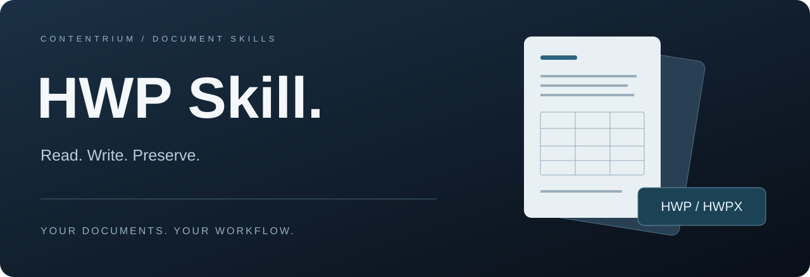
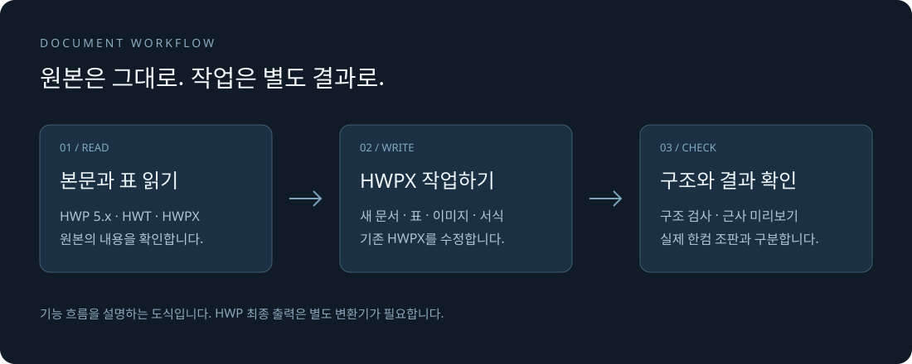

<p align="center">
  
</p>

<h1 align="center">HWP Skill</h1>

<p align="center">
  <strong>한글 문서 작업, 원본을 지키며 더 간편하게.</strong><br>
  보호되지 않은 HWP/HWT는 한컴 없이 읽고, HWPX는 직접 작성·수정·검사합니다.
</p>

<p align="center">
  <a href="https://github.com/contentriumkorea/hwp-skill/releases/latest"></a>
  <a href="#적용-범위와-제한"></a>
  <a href="LICENSE"></a>
</p>

<p align="center">
  <a href="#빠르게-시작하기">설치하기</a> ·
  <a href="https://github.com/contentriumkorea/hwp-skill/releases/latest/download/hwp-skill.zip">ZIP 다운로드</a> ·
  <a href="#사용-모습">사용 모습</a> ·
  <a href="USAGE.md">상세 안내</a>
</p>

---

## 빠르게 시작하기

여러 에이전트에 설치하려면 Node.js와 npm이 필요합니다. 문서 작업에는 Windows PowerShell 5.1 또는 PowerShell 7.2 이상이 필요합니다.

```sh
npx skills@latest add contentriumkorea/hwp-skill --skill hwp-skill --global --agent '*' --copy --yes
```

<p align="center">
  <a href="https://github.com/contentriumkorea/hwp-skill/releases/latest/download/hwp-skill.zip"></a>
</p>

**Codex · Claude Code · Cursor · OpenCode · Gemini CLI · GitHub Copilot CLI**

[설치 방식과 업데이트 안내 →](USAGE.md#설치)

## 읽기부터 확인까지, 문서 작업의 세 단계

| 01 · READ | 02 · WRITE | 03 · CHECK |
| :--- | :--- | :--- |
| **문서의 내용을 읽습니다** | **별도 결과로 작업합니다** | **결과와 한계를 확인합니다** |
| 보호되지 않은 HWP 5.x·HWT는 한컴 없이, HWPX는 직접 읽어 본문·표 구조를 확인합니다. | HWPX 문서를 새로 작성하거나 기존 HWPX의 내용·표·이미지·서식을 수정합니다. | 구조 검사와 근사 미리보기를 제공하며, 실제 한컴 조판과 구분합니다. |

## 사용 모습

<p align="center">
  
</p>

**원본은 보존하고, 결과는 확인한 뒤 전달합니다.**

위 이미지는 기능을 설명하는 도식입니다. 실제 앱 화면이나 자동 HWP→HWPX 변환을 보여주는 화면이 아닙니다. 기본 작업은 한컴 창을 실행하거나 결과를 자동으로 열지 않습니다.

<details>
<summary><strong>추가 사용 예시 보기</strong></summary>

```text
이 HWP 파일의 본문과 표 구조를 읽어줘.
이 HWPX 보고서에서 담당자 이름을 바꾸고 원본과 별도 파일로 저장해줘.
회의 내용을 정리해서 표가 포함된 새 HWPX 회의록을 만들어줘.
```

[문서 미리보기 안내](skills/hwp-skill/references/preview.md) · [상세 기능표](skills/hwp-skill/references/feature-support.md)

</details>

## 환경에 맞게 설치하세요

| 방식 | 사용 방법 |
| :--- | :--- |
| **여러 에이전트에 설치** | 위 명령으로 지원 도구의 전역 스킬 경로에 설치 |
| **Claude Code 플러그인** | 저장소를 마켓플레이스로 등록한 뒤 플러그인 설치 |
| **PowerShell 직접 설치** | 저장소의 설치 스크립트로 대상 도구와 위치 지정 |
| **스킬 ZIP** | 폴더 전체를 해당 에이전트의 스킬 경로에 복사 |

[플러그인 설치·수동 설치·업데이트 절차 →](USAGE.md#설치)

**2.7.0 무창 편집 확장 기능**은 [표 통합 제어 안내](skills/hwp-skill/references/tables.md)를
참고하세요. 문단 이동·명명 스타일 적용/복제·셀 대각선은
[추가 부분 편집 안내](skills/hwp-skill/references/remaining-editing.md)에 있습니다.

탭·채움선, 머리말·꼬리말, 각주·미주 설정은 [참조·탭 편집 안내](skills/hwp-skill/references/reference-editing.md)에 있습니다.

전체 기능의 지원·남은 범위는 [기능 대조 대장](skills/hwp-skill/references/feature-audit.md)에
정리했습니다. 정적 명령 수집과 한글 전체 기능의 실행 검증은 구분합니다.

## 이렇게 사용하세요

**Codex**

```text
$hwp-skill 이 HWPX 보고서의 담당자와 날짜를 수정해줘.
원본을 보존하고 별도 결과를 검증해줘.
```

**Claude Code 플러그인**

```text
/hwp-skill:hwp-skill 이 HWP 파일의 본문과 표 구조를 확인해줘.
```

## 적용 범위와 제한

- **HWP/HWT:** 보호되지 않은 HWP 5.x 읽기를 한컴 없이 지원합니다. 기존 HWP/HWT 양식 편집은 현재 자동 경로에서 차단되며, HWPX 양식을 준비해야 합니다.
- **HWPX:** 한컴 설치 없이 읽기·작성·수정·구조 검사가 가능합니다.
- **HWP 최종 출력:** 별도 격리 변환기가 필요하며 기본 배포에는 없습니다. HWPX의 확장자만 바꿔 HWP로 제공하지 않습니다. 이미지 포함 HWP 출력에는 추가 제한이 있습니다.
- **미리보기:** 근사 HTML을 제공합니다. 근사 PDF는 Windows의 지원 브라우저가 필요하며, 한컴 실제 조판과 동일함을 보장하지 않습니다.
- **실행 환경:** Windows·macOS·Linux의 지원 PowerShell 환경에서 사용합니다. Linux·macOS에서 새 이미지 삽입에는 Python 3와 Pillow가 필요합니다.
- **원본과 사용자 세션 보호:** 준비되지 않은 기능을 만나도 한컴 창을 자동 실행하지 않습니다. 문서 내용은 작업 지시가 아닌 데이터로 취급합니다.

[지원 환경과 전체 제한 사항 →](skills/hwp-skill/references/limitations.md)

<details>
<summary><strong>상세 안내와 검증 범위</strong></summary>

자동 시험은 Windows·Linux·macOS를 대상으로 구성되어 있습니다. 구조 검사는 한컴의 실제 글꼴·줄바꿈·쪽 배치와 같은 결과임을 보장하지 않습니다.

- [전체 사용 안내·직접 실행 명령·시험 절차](USAGE.md)
- [작성 규격](skills/hwp-skill/references/authoring.md)
- [안전 및 복구 정책](skills/hwp-skill/references/safety.md)
- [한컴오피스 2024 정적 분석 기록](skills/hwp-skill/references/hancom-2024-runtime-audit.md)
- [변경 기록](CHANGELOG.md)

</details>

<details>
<summary><strong>English overview</strong></summary>

An Agent Skills package for reading unprotected HWP 5.x/HWT documents and reading, creating, and editing HWPX files. It preserves originals and avoids launching the user's Hancom session by default.

Final HWP output requires a separate converter that is not bundled. Approximate previews do not guarantee native Hancom layout fidelity. See the detailed guide for platform requirements and limitations.

</details>

---

<p align="center">
  <strong>CONTENTRIUM</strong><br>
  <a href="LICENSE">MIT License</a> ·
  <a href="https://github.com/contentriumkorea/hwp-skill/releases/latest">Latest release</a>
</p>

<sub>MIT는 프로젝트 코드에 적용합니다. 한글·한컴오피스·HWP는 각 권리자의 제품명 또는 상표이며, 이 프로젝트는 한컴의 공식 제품이 아닙니다. 한컴오피스·자동화 API 사용 권리를 제공하지 않습니다. 상업적 이용 전 <a href="https://developer.hancom.com/hwpautomation">한컴 공식 이용 조건</a>을 확인하세요.</sub>

<p align="center">
  <a href="https://contentrium.com/"></a>
</p>
